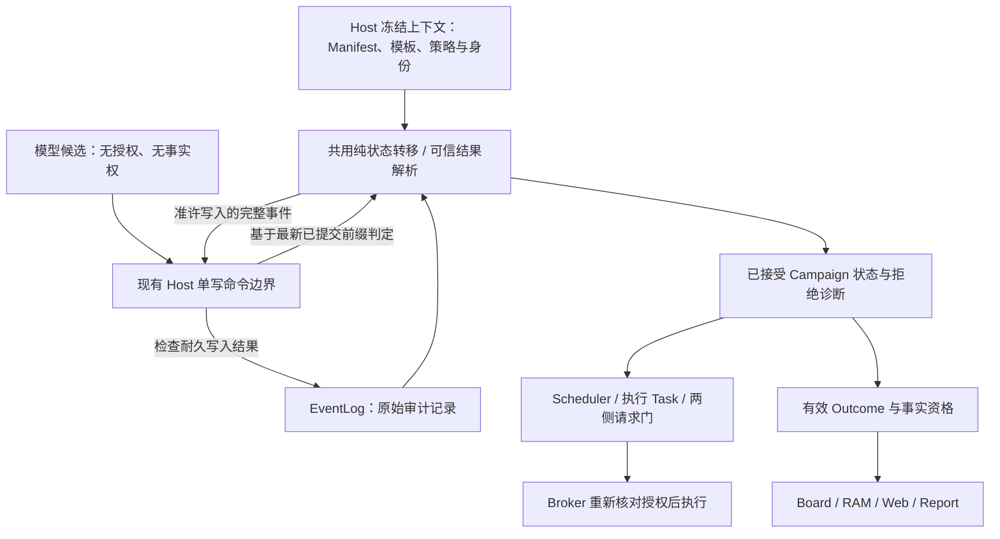

# E1 历史任务与实现审计（2026-10-15）

审计对象：北京时间 `2026-10-14 17:00:00` 至 `2026-10-15 03:00:00` 的 Git 任务，
以及当前 `audit/completion-20261015` / `3d8c610` 实现。开始时工作树 clean。
本文先分析、复现并冻结修复依据，不修改产品实现。

**结论：E1 自动规划集成仍为 `changes_required`。** 四组 P1 当前阻塞已经复现：
动态 Task 的实际请求忽略自身分配、多个计划累计超额准入、Board 提升权威拒绝的结果、
Plan replay 接受不完整身份及不对应的执行定义。另有一组 P2 根目标引用绑定遗漏。
这是跨模块契约没有统一落实的问题；补几个非空字段检查不足以修复。

## 1. 项目判断与审计边界

可运行主链是 config/Manifest → SDK Worker 的模型提案 → Host/Scheduler 准入与调度 →
Broker 受限文件动作 → 独立 Oracle → EventLog → queue/Board/观察页/模型 RAM。
Event、Outcome 与 Experience 的区分和既有请求生命周期机制保留。
本轮结论聚焦新完整计划接入旧主链时的授权、身份、预算与事实投影。

- 真实 SDK/faux 正常完整计划可以完成：8 次离线模型请求、3 次 Broker 文件效果，
  三个业务 Task 都由实际 Oracle 结果完成。这证明主链可运行，不证明边界正确。
- C1-C6 的既有限定接受范围作为历史基线保留；本轮没有重跑全项目 59/62 脚本，
  也没有重新认证 C1-C6。没有发现依据要求推倒已验收请求生命周期。
- 自动规划、可信白板与恢复尚有当前可达缺陷。真实模型解题能力、学习收益、自动 CTF
  和通用工程能力不在本轮离线证据能够证明的范围。
- 嵌入 Pi HEAD 为 `42a3497d03ad17e308a2299fa824727894f2c0ec`，工作树 clean。
  本轮没有修改 Pi、产品模块、用户配置、依赖或历史日志，没有调用真实 provider/目标。

## 2. 时间窗口内的任务还原

采用 `git log` 的 commit 时间，时区 `+08:00`，窗口内共 18 个提交。
初版实现的 `e568d7f`（16:54）、`458e467`（16:55）、`24cb506`（16:58）及
`d92ae85`（16:59）位于窗口前；17:12 是它们的交付报告，不能将初版缺陷全归到窗口内补修。

| 时间 | commit | 任务/作用 | 本次核查判断 |
| --- | --- | --- | --- |
| 14 日 17:12:50 | `c9ed6b4` | 初版 E1 可观察规划报告 | 正常链已接入，不能据报告推断契约闭合 |
| 19:48:33 | `00c6d2e` | 外部 17 例边界审查 | 历史 4 pass / 13 fail，是有用的失败基线 |
| 20:04:54 | `e3f9cf9` | 限定 Task A | 先处理规划终止及独立激活门，范围合理 |
| 21:07:43 | `bc93cca` | Task A 产品修复 | 正常/unknown/error/aborted、结清、独立 Oracle/completion 门已实装；保留已接受范围 |
| 22:58:47 | `90a743e` | A 故障/重启补测 | 本轮 2/2 通过；没有由此覆盖 missing identity 恢复 |
| 23:08:36 | `ff0e4d7` | B/C 分任务交接 | 任务划分清楚，但后续实现仍需共用权威判定 |
| 23:49:08 | `94463cc` | Task B 冻结规划输入/可信模板 | 实际输入与 criterion 子集约束成立；root ref、预算执行和多提交未闭合 |
| 23:49:17 | `5900130` | B 测试 | 本轮 6/6，通过范围有限 |
| 23:49:25 | `beb79c0` | B 报告 | 不应据此扩大为整体规划准入完成 |
| 15 日 00:08:24 | `d3f6630` | Task C 观察重放、Campaign Facts、计划 digest | queue 证据索引已接通；Board 另写弱判定，见 HI-03 |
| 00:08:32 | `c457474` | C 测试 | 本轮 6/6；缺失/未知用例未覆盖存在但不合法的结果 |
| 00:08:32 | `f6baca7` | C 报告 | 原 17 例全绿只代表该集合通过 |
| 00:09:15 | `2d166fc` | 修正 tsc 基线报告 | 正确保留非零类型基线；本轮未复跑 tsc |
| 01:19:56 | `8c0ab19` | fail-closed 任务与标准 | 规格要求完整绑定、整批校验、失败前零 mutation |
| 01:20:07 | `17d7aff` | FC Outcome/Plan 修复 | 部分字段及 digest 已检查；missing 与 mismatch、存在与合法仍被混淆 |
| 01:20:20 | `7a02e58` | FC 17 例及 fixture 迁移 | 本轮 17/17；未覆盖 CA/HA 中的交叉边界 |
| 01:20:20 | `381829a` | FC 交付报告 | 它是产品基线，不是完整 fail-closed 证明 |
| 02:03:45 | `3d8c610` | 独立完成度审计 | 原 12 例本轮仍 3 pass / 9 fail；问题并未消失 |

窗口内直接改产品的核心提交是 A、B、C、FC 四次；其余为测试/任务/报告。
`git blame` 显示 HI-01/02/05 主要继承自窗口前初版；C/FC 新增的 Board 判定与 FC
可选身份比较分别留下 HI-03/04。这里描述引入/保留的位置，不根据时间推断作者动机。

## 3. 已复现发现（按处理优先级）

### HI-01：动态 Task 的分配没有进入实际请求门 — P1 / current_blocker

位置：`memory/campaign/e1-plan-contract.mjs:463` 只输出 `budget_reservation`；
`scheduler.mjs:524` 将该定义原样交给 Worker；`c6-entry.mjs:842` 只读取
`task_budget`，缺失就回退 Campaign 总限额（849–854）。

HA-02 把三个子 Task 的 `model_requests` 分配均设为 1。实际各请求 2 次，
全部 completed，并产生 3 次 Broker 文件效果，rejected 为零。
这不是记账展示误差：真实 provider 边界没有使用已准入 Task 的额度。
Campaign 请求门仍存在，本用例没有证明总实际请求超过 Campaign 限额。
单任务超额已经违反 OP-L 的双侧预算，不需等付费实验才能确认。

### HI-02：多个候选复用旧快照，重复准入并超额分配 — P1 / current_blocker

位置：`c6-entry.mjs:135` 无条件 push 候选；1010–1018 只构建一次 projection；
1024–1037 循环准入并仅返回最后结果；`scheduler.mjs:748` 选择最后一批准入计划激活。
`projection.mjs:957` 的批次应用也未独立重验累计额度/一次有效计划约束。

HA-03 在一个正常 SDK 响应中调用两次 `aegis_submit_plan`，使用不同 Plan/Task ID。
每批三个 Task、各 20 请求；单批 60 加规划分配 8，小于总限额 100。
第一批后 reserved=68，第二批后 **reserved=128 > 100**，两个计划均 admitted，
第二批执行 6 次业务请求并产生 3 次文件效果，第一批三个任务仍 queued。
这是 Host 生成的真实 committed 流，没有改写日志；无需伪造 Oracle 或越权工具。
128 是承诺分配，不是声称已经请求了 128 次。实际 Campaign 消费是 8 次。

提示词的“ONCE”和 buffer 注释的“ONE”没有形成强制规则。
仅加 buffer 限制也不够：可信 Host/reducer 仍须拒绝第二个有效批次并保留首次合法状态。

### HI-03：Board 接受权威队列拒绝的结果 — P1 / current_blocker

位置：`memory/runtime/board.mjs:143` 只检查 criterion 非空；247 附近只检查 evidence
存在；648–658 从原始 admission/start 建索引，不考虑 reducer 是否接受。
权威 `outcome-resolver.mjs:24/133` 已有 scope、criterion、独立性及可解析引用校验，
Board 没有复用它们。`c6-entry.mjs:884` 将同一 Board 放入模型 RAM。

CA-02/03/04 分别修改实际 Oracle 的 scope、criterion、artifact ref，权威队列拒绝并
保持任务未完成，Board 却各生成 2 个 Fact。CA-05 的 admission 已被权威拒绝，
Board 仍从原始动态定义生成 2 个 Fact。这会把已拒绝的判断变成模型下一步的可信指导。

这些用例重算并验证完整事件链，证明业务校验分歧；没有声称模型可以伪造 Oracle 来源。
观察页原始 candidate 状态的独立事件扫描也有同类分叉，应随统一投影处理。

### HI-04：replay 未证明身份、候选与执行定义的对应 — P1 / current_blocker

位置：`projection.mjs:834` 接受缺规划身份及内外 plan_id 不同的 submitted；
939 仅“两边都有且不同”才拒绝；957 只做有限 definition 结构校验；
995 对非法 reservation 回退零；634 的 ready 身份检查也允许缺失。
重复 admitted 在 905–910 只比 candidate digest，不能证明 normalized 批次完全相同。

CA-06/07 缺 submitted/admitted 规划身份、CA-08 改 normalized target 而候选/digest 不变、
CA-09 内外 plan_id 不同，都被接受。CA-12 从缺双方 planning_task_id 的真实 ready 前缀
启动新进程，仍执行 **6 次离线业务请求 / 3 次 Broker 文件效果**。
合法身份前缀的 CA-11 对照正常通过。

CA-08 证明错误执行定义进入队列及错误完成状态，没有证明最终 Broker 越权写文件；
CA-12 是 durable 前缀恢复，不冒充 SIGKILL 测试。具体输入及旧 9 例细节见
`PROJECT_COMPLETION_AUDIT_20261015.md`，本轮已重新运行验证。

### HI-05：root_goal_ref 只有形状检查 — P2 / non_blocking

位置：`e1-plan-contract.mjs:74` 要求非空字符串；`validatePlanGraph` 没有与冻结 context
中的 root_goal_ref 比较。HA-04 只将其改为 `foreign-root`，仍 admitted/completed，
8 次请求 / 3 次文件效果。

这是现有 OP-P 身份契约遗漏，应并入 HI-04 修复。当前单根目标/固定模板路径中，
它没有解除模板 criterion 覆盖和 target/capability 校验，未证明 foreign Campaign 执行，
所以不把它单独升为授权越界 P1。多根目标/导入计划接入时须重新评估等级。

## 4. 为什么已有测试全绿仍有这些错误

不是原测试没有价值，而是覆盖面与交付结论不匹配：

1. FC-O 重点删除 task/episode/stage/source/evidence 字段；没有证明“字段存在但值不属于
   当前任务/作用域、证据引用不能解析”时 Board 与 queue 一致。
2. FC-P-05 测双方都有且不相等，没有测单边/双边缺失；digest 冲突用例也没有改变
   normalized 执行定义并保持候选 digest 不变。哈希一致不能代替语义和归属校验。
3. 正常产品 fixture 给子任务 4 次额度、实际只用 2 次，掩盖了 Task 分配根本没接到
   provider gate；所有正常规划只提交一次，掩盖旧快照和累计预算错误。
4. live 走 `validatePlanGraph`，replay 走另一套较弱的 `validateDynamicDefinition`；
   queue 走 Outcome Resolver，Board 又手写判定。函数名和注释声称“same/whole/fail closed”，
   并不能保证调用链共用同一个可信决策。

## 5. 后续修复任务与依赖（分析交付，尚未实施）

以下 R1–R4 是缺陷定位与验收分组，不是四个独立产品任务。它们共同完成同一个
E1 可观察规划任务；后续实现应先按第 8 节冻结共用状态、接口和恢复契约，再按依赖迁移。
不能将某一组测试转绿视为整条主链完成。

| 顺序 | 工作单元 | 范围/目标 | 验收证据 |
| --- | --- | --- | --- |
| R1 | Task 实际额度接线 | 动态/静态 Task 规范化到同一预算接口；缺失/非法不默认扩大到 Campaign；请求门和恢复读取同一分配；保留两侧结清机制 | HA-02；额度内正常、恰好耗尽、耗尽 continuation；恢复不重置消费 |
| R2 | 统一计划准入与恢复 | 一次有效计划、完整身份/root、冻结模板来源、候选到 normalized 对应、全图和累计分配；live/reducer 共用纯校验，先验证全批再 mutation；精确重复幂等，冲突不覆盖 | HA-03/04、CA-06..09/12，加完全重复与冲突 normalized 批次的正负例 |
| R3（依赖 R2） | 单一可信结果投影 | Board 使用已接受 Task/episode/Outcome 与同一 Resolver/证据索引；模型 RAM、观察图和候选状态使用一致结论；拒绝保留 Hint/reason | CA-02..05，以及正常 Fact/unknown/correction 原断言 |
| R4（依赖 R1–R3） | 限定集成验收 | 本次 16 例与原 A/B/C/FC 保持原断言；按 required 清单执行受影响 C6/回归；更新同一报告的真实结果 | 所有阻塞复现转绿、正常对照仍绿、类型与静态检查诚实报告 |

共用契约冻结后，R1 的接线可独立推进；R2 为 R3 提供合法定义及 Outcome 绑定输入。不能只改页面过滤、
`if (a && b)` 的一处表达式或复制新的 evidence 检查来关闭这组任务。
replay 若需要模板，须获得与准入相同的可信冻结输入和身份绑定，不能信任 admitted
事件自报模板或空模板 fallback。保留已接受的 A/C6 终止、独立 Oracle、持久提交及 Broker 门。

文档入口 `docs/README.md` 仍以较早 C6 16 例/3 fail 状态为“当前”，而 AGENTS 与
最新审计不同；这是非阻塞交接债。后续集成时统一当前入口，历史证据保留日期和基线。

## 6. 本轮实际验证

最终复跑精确命令（退出码 **1**，失败来自真实审计行为断言）：

```bash
node Pi_Agent_base/tests/helpers/c6-suite-runner.mjs \
  Pi_Agent_base/runtime/dev/history-audit-20261015/final \
  aegis-e1-external-review aegis-e1-fail-closed-repair \
  aegis-e1-planner-input aegis-e1-observation-repair \
  aegis-e1-planning-gate-audit aegis-completion-audit aegis-e1-history-audit
```

| 脚本 | 本轮 cases | exit |
| --- | --- | --- |
| external-review | 17/17 pass | 0 |
| fail-closed-repair | 17/17 pass | 0 |
| planner-input | 6/6 pass | 0 |
| observation-repair | 6/6 pass | 0 |
| planning-gate-audit | 2/2 pass | 0 |
| completion-audit | 3 pass / 9 fail | 1 |
| history-audit（新增） | 1 pass / 3 fail | 1 |

原修复 5 脚本共 48/48 cases 通过；两套审计共 **16 cases：4 pass / 12 fail**。
12 是失败用例数量，不等于 12 个独立根因。7 脚本中 5 pass / 2 fail，没有 skip/xfail。
逐项 argv/exit/log：`Pi_Agent_base/runtime/dev/history-audit-20261015/final/results.json`。
最终原审计输入/摘要：`runtime/dev/completion-audit-20261015/independent/cases-Ox6iif/`。
最终新审计输入/摘要：`runtime/dev/history-audit-20261015/live/cases-XSi4zS/`。
这两个相对路径均以 `Pi_Agent_base/` 为根；证据保持 ignored 私有文件。

新增测试保留正常对照与真实效果计数；既有断言未削弱。产品未修复，测试保留红色回归基线。
本轮未运行全量 required、tsc、真实 provider、目标网络或学习效果实验。

静态检查以下两条均退出 **0**；Biome 检查 2 个文件，无待修格式问题：

```bash
./Pi_Agent_base/pi/node_modules/.bin/biome check \
  --config-path=Pi_Agent_base/aegis-biome.json \
  Pi_Agent_base/tests/aegis-e1-history-audit.mjs \
  Pi_Agent_base/tests/helpers/c6-e1-planning-child.mjs
git diff --check
```

## 7. 补充检查矩阵（运行前冻结，现补实际结果）

依据 `E1_OBSERVABLE_PLANNING_TASK.md` OP-P/OP-A/OP-L：Host 绑定冻结根目标；
本轮一次有效计划；总分配与每侧实际请求额度都受约束。模型提示不能代替 Host 校验。
新检查使用已有真实 SDK/faux 子进程、Broker、Oracle 和 EventLog；不改写事件制造正例。

| case_id | requirement / phase | level / input_origin | setup / action | expected / assertion_evidence | old_code_expected_failure |
| --- | --- | --- | --- | --- | --- |
| HA-01 | OP-P/A/L / 正常链 | product / model_proposal | 一个完整合法计划，三个业务任务 | 仅一个批次；8 次离线请求、3 次 Broker 文件效果、数据修复、事件链合法 | 否，正例对照 |
| HA-02 | OP-L / Task 侧额度 | product / model_proposal | 与正例相同，每子任务 model_requests=1；模型在决策工具后请求 continuation | 各业务 Task 实际请求≤1；额度耗尽导致规划未完成时不得调用 Broker；从实际 request.committed 和效果计数断言 | 是，normalized 只有 budget_reservation，Worker 读取 task_budget |
| HA-03 | OP-A / 一次有效计划与累计额度 | product / model_proposal | 同一 SDK 响应提交两个不同 plan_id、互不重叠 Task ID；每批额度单独合法，合计超限 | 至多一批准入；所有 admitted 前缀的 committed allocation≤Manifest 三维限额；断言真实事件及前缀投影 | 是，循环使用旧 projection，且没有单计划限制 |
| HA-04 | OP-P / 冻结根目标身份 | product / model_proposal | 正例仅把 root_goal_ref 换成 foreign-root | 显式 blocked/rejected、无动态任务、无业务请求/效果；候选保留 | 是，当前只检查非空字符串 |

责任阶段均为 E1；HA-02/03 若复现属于 `current_blocker`，HA-04 按实际身份影响定级。
脚本：`Pi_Agent_base/tests/aegis-e1-history-audit.mjs`。
精确命令：`node Pi_Agent_base/tests/aegis-e1-history-audit.mjs`。
初始状态均为 `not_run`。最终 HA-01 pass；HA-02/03/04 fail，脚本 exit 1。
log 为 `runtime/dev/history-audit-20261015/final/aegis-e1-history-audit.log`，
输入/计数/前缀 projection 为上述 `cases-XSi4zS/` 的分场景 diagnostic JSON。

## 8. 将多轮补修还原为一个架构问题（2026-10-15 补充分析）

本节回应用户指出的“同一个任务反复修复、关键设计不清”的问题。前述 A/B/C/FC 是
同一产品承诺的多轮交付，不能各自形成一套成功语义。本节为源码核对后的设计建议，
没有修改已确认架构、事件协议或产品实现，也不声称新接口已经存在。

### 8.1 根因：行为规格有要求，但模块间缺少强制共享的语义接口

不能把所有缺陷归为原始需求没写清。原任务书已经规定：

- OP-B：Board 复用 Outcome 可信性、归属与证据解析，unknown/foreign/未准入不能成为 Fact。
- OP-A：本轮一次有效计划；reducer 整图校验、全批应用；同一累计预算包含静态任务。
- OP-L：每次请求同时受 Task 和 Campaign 约束，耐久结清与规划终止分别成立。

但这些主要作为文字要求分散在任务书和修复标准中，没有成为所有入口必须使用的
数据模型与状态转移。实现中存在以下断点：

| 断点 | 当前代码事实 | 设计没有落实的部分 |
| --- | --- | --- |
| 同一事件流，被不同模块解释成不同真值 | queue 调 Resolver；Board 自建 task/episode 索引并另写分类；观察候选又扫描原始事件 | 原始记录、已接受状态转移、有效判断三个层次没有统一输出；“读同一日志”不足以保证结论相同 |
| 计划验证与计划恢复分离 | live 用 `validatePlanGraph`；replay 只验证有限 definition 结构 | 缺少由同一可信冻结输入确定候选→执行定义的函数；恢复上下文的来源和缺失行为没有贯通 |
| 校验与提交分离 | entry 用外部 projection 求 admission；`scheduler.admitPlan` 接收调用方的 admission 后写入 | 谁负责读取最新状态、重新判定、耐久提交及确认 reducer 接受，没有形成一个完整命令边界 |
| 同一执行对象有两种预算字段 | 静态 Task 为 `task_budget`；动态定义为 `budget_reservation`；Worker 只读前者 | 缺少唯一的执行 Task 规范与预算适配边界；默认值扩大权限时没有被接口阻止 |
| 身份与幂等没有覆盖整个对象 | candidate digest 已统一，但 normalized 定义、冻结模板及规划身份未完整绑定 | “相同计划”的精确定义、摘要覆盖、重复与冲突的判定责任没有共同实现 |
| 局部验收代替整体闭合 | missing 测试通过，值非法/交叉入口/多次提交仍失败 | 缺少跨入口一致性、序列和故障前缀的不变量验收 |

现有 `c6-request-lifecycle.mjs` 是可保留的局部范例：明确三种独立事实，并将 live 与
rebuild 的共同规则集中。E1 没有把这种做法延伸到计划、执行定义和可信结果。
结论不是重写整个项目，而是收拢 E1 主链的决策权，让局部实现无法再自行解释关键语义。

### 8.2 建议的权威边界与数据流



这是现有模块的职责收敛，不要求新增服务、数据库、事务引擎或多 Worker。
不同视图可以各自组织、分页和渲染；执行资格、成功判定和 Fact 资格必须来自同一决策。
Board 仍负责节点关系、历史、supersedes 与失效展示，不能独自产生 Campaign 成功权威。

编码前应冻结以下五项共用契约及全部实际调用点：

| 契约 | 唯一语义与责任 | 缺失/冲突行为 |
| --- | --- | --- |
| 冻结运行上下文 | Host 提供 Campaign/Manifest revision 与 digest、根目标/必需判据、规划 Task/实际 Episode、模板/注册表及策略身份 | 不能用模型字段或 admitted 自报内容补权限；恢复缺可信模板/上下文时阻止新执行并展示原因 |
| 执行 Task | 静态与动态输入在边界适配为同一执行定义，含精确身份、目标、能力、依赖、Oracle/criterion、scope、三维额度 | Worker 只消费这一规范；已准入动态 Task 不得缺额度再回退 Campaign 总额；旧静态缺省规则只在原兼容边界解析一次 |
| 计划决定与转移 | 确定性规范化与全图策略共用；读取当前已接受状态，对一次有效计划、引用、全图和累计分配判定 | 先完成所有检查再应用；调用者传 `status=admitted` 不能授予任务执行权 |
| 可信 Outcome | 共用 Resolver 产生已绑定的 judgment、证据解析结果、拒绝原因及来源引用；Fact 资格还遵守原有效性/修正规则 | 无定义、foreign、引用不可解析或 invalid 均不成为 Fact；合法 unknown 保留 judgment；failure 不自动成为 Refuted |
| 命令提交结果 | 区分候选 buffered、记录 durable、转移 accepted、计划 activated；Host 负责当前状态下判定及写后确认 | append 成功只说明记录耐久；reducer 未接受时不得返回 admission 成功或 dispatch；耐久失败继续原 C6 停止/未决语义 |

建议沿用 `e1-plan-contract` 的纯编译/校验、`projection` 的状态转移、
`outcome-resolver` 的判断、`scheduler` 的单写提交职责；entry 负责适配与接线。
共用规则必须被真实 live/replay 入口调用，而非保留两套旧实现再增加一个无人调用的 helper。
调用方向须避免 Board↔queue 互相重建：可信判断由下层纯契约提供，Board 消费判断结果。

### 8.3 必须说清楚的状态、预算与身份

**状态是多条独立轴。** 候选记录、完整准入、规划终止、请求结清、规划 Oracle/completion、
计划激活、业务结果各自成立。子任务的必要执行条件为：完整批次获准且耐久、规划正常
终止、规划请求结清、规划独立验收与完成记录匹配、同一计划被合法激活、依赖可信完成，
再通过当前授权/预算/停止门。不能把这些事实折成一个 `ok` 或用最近一条 success 代替。
规划成功不等于根目标成功，根目标仍依赖冻结的业务判据。

**预算有三种不同含义。** Task allocation 是分配上限；request hold 是一次请求每侧的
责任；consumed 是已确认使用量。分配预留与请求 hold 不能在同一个 remaining 公式中
重复扣减；也不能因为 Campaign 还有余额就忽略 Task allocation。准入看“已消费 +
尚未消费/释放的已承诺分配 + 新分配”是否在 Campaign envelope 内；实际 provider 门
分别看 Campaign 与 Task 的已消费、请求 holds 及自身 limit。请求消费必须与分配的
剩余承诺衔接，不能另记一套无关联数字。具体字段映射及释放时点须先在契约表列清。

例如 Campaign=20、规划分配=6、三个业务 Task 各4：承诺18；各实际使用2后，在尚未
释放未用分配、无 pending/unresolved 时，实际消费8、剩余未消费分配10、未分配空间2。
实际请求余额12与可新增分配空间2是不同值。
请求异常时两侧责任可能不同，沿用 C6 的逐侧结清和 unresolved，不以数值相等猜结清；
恢复、换 Session 或拒绝后续计划不能抹掉任何已有消费/未决。

**身份不能只有一个哈希。** 必须定义 Campaign/revision/root、规划 Task/Episode、
plan_id、原候选摘要、可信模板/策略身份、规范化执行定义摘要之间的绑定。
候选内容摘要只证明候选相同，不能证明 Host 编译的定义合法；后者须由相同可信输入
确定性导出并核对，单独增加 normalized digest 也不能替代重验。
同 ID 且候选、上下文及规范化定义完全一致才是幂等；同 ID 不同内容拒绝且不覆盖。
在本轮同一 Campaign revision/root 的规划范围内，第一份合法准入后不接受另一有效
计划；先前非法候选不预占 Task/预算。多候选保留审计，按耐久顺序处理；增量重规划仍后置。

**当前前缀决定准入。** 每个 Host 命令在现有单写边界内取得最新已接受前缀，调用共用
转移判定，再耐久写入并确认相同前缀上的转移结果。不得在等待写入期间让其他命令
插入并改变此前提，沿用现有单写/所有权机制。后续命令必须包含前一次合法提交；
不能继续使用 entry 提前读取的快照。失败/拒绝只增加诊断，不部分改变执行图与额度。
这解决串行代码中的旧快照问题，无需为本轮单活动 Task 引入分布式事务。

### 8.4 恢复与验证要证明同一规则，而非再次补一组字段

原始事件流是审计源；有效状态是可信上下文对事件按顺序作合法转移后的结果。
“来源合法、链完整、append 成功”均不能独立证明某条业务转移有效。被拒记录可在
history 中显示，但不能被其他投影重新用作 Task 定义、完成证据或 Fact。

冻结模板/策略若不在 Manifest 内，应明确在启动前由 Host 保存可信规范副本及其绑定，
恢复从同一副本加载；具体持久 shape/版本需在实施前冻结。不能读已变化的当前配置
重新解释旧事件，也不能只相信 admitted 事件自报模板。只读审计可显示缺上下文；
执行恢复在无法证明绑定时保持 blocked。保留旧日志，不自动重写；planning 关闭的旧
配置保持原兼容行为，旧 E1 数据的恢复能力须按真实可用上下文逐类说明。

后续验收先写这些不变量，现有 CA/HA 作为已失败的具体实例；新增项目前均未运行：

| 不变量 | 需要证明的范围 | 已有依据 / 后续验证 |
| --- | --- | --- |
| 一致重建 | 同一冻结上下文与每个 committed 前缀，live 重放及 fresh-process 恢复的有效任务、身份、预算、判断相同 | CA-11/12、A writer-fault 为部分依据；补逐前缀对照，不能把它替代真实断电/SIGKILL 检查 |
| 拒绝无执行效力 | 拒绝不改变已接受 Task/预算/Fact，保留诊断；后续视图不能重新提升 | CA-02..09、HA-04 |
| 幂等与一次有效计划 | 完全重复不新增 Task/预留/效果；同 ID 冲突不覆盖；不同 ID 后续计划不能突破一次有效计划 | HA-03 为部分依据；补重复、冲突及先非法后合法序列 |
| 预算贯通 | Task 分配约束实际请求；两侧请求责任不丢失；未决/重启/换 Session 不增加剩余分配或抹消费 | HA-02 与既有 C6 生命周期断言；补额度边界及恢复数值对照 |
| 可信结论一致 | queue/Board/RAM/Web/Report 对同一 Outcome 是否可信、是否满足 criterion 无分歧，unknown/修正历史保留 | CA-02..05 与原 Board/unknown/correction 断言 |
| 编译来源一致 | 改候选、模板、身份或任一有执行意义的 normalized 字段均不能保留原有效准入；无可信上下文不执行 | CA-06..09/12、HA-04 为部分依据；补模板绑定与缺上下文测试 |

这些是确定性的序列与故障检查，可用当前 Node 测试工具实现，不需要新增测试平台。
同一边界在 live 与 replay 都校验是必要的；两处调用同一纯规则，并明确不同的 I/O
职责。不能把“共用”误解为删掉执行边界的授权检查。

### 8.5 调整后的实施交付单位

先交付一个可审查的契约切片：冻结上下文、执行 Task shape、状态转移/拒绝原因、
预算字段/释放语义、身份/摘要覆盖、恢复输入和调用点表，明确兼容影响。随后先让
计划命令与重放共用规则，再接通统一 Task 预算，最后让各消费者读取同一可信判断。
迁移时逐个删除被替代的 Campaign 判定分支，保留既有非 Campaign Board 行为与原断言。

验收单位始终是“完整 E1 主链”，R1–R4 只是同一任务内的实现步骤。每步有局部证据，
最终按同一套不变量和受影响 required 集统一验收，不能用新增文档、字段检查或测试总数
代替契约落实。本次补充只做源码与规格对照、更新分析文档；未复跑测试或改变上一轮结果。
