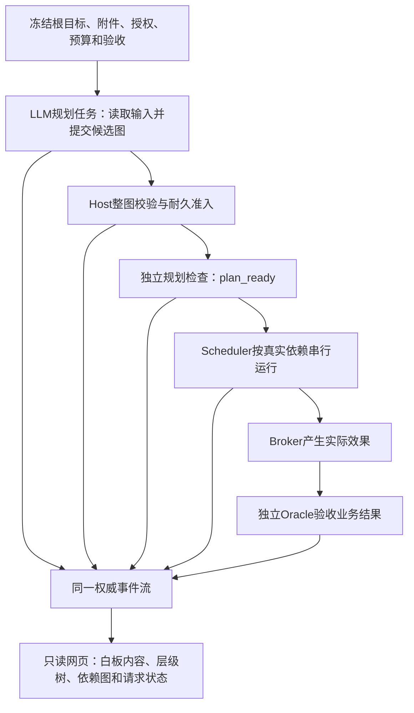

# E1 可观察规划工程：任务书与实施指南

状态：**待 DS 实施；本文件是规格，不是实现/验收结果**。
日期：2026-10-14。检查起点：`feat/c6-agent-product` / `2bf4485`，工作树干净。
内嵌 Pi：`42a3497d03ad17e308a2299fa824727894f2c0ec`，干净。
用户要求：完整展示白板节点内容和任务依赖树，并由 LLM 拆分任务；为下一轮 CTF 测试准备。
测试矩阵：[E1_OBSERVABLE_PLANNING_TEST_MATRIX.md](E1_OBSERVABLE_PLANNING_TEST_MATRIX.md)。
总提示词：[E1_OBSERVABLE_PLANNING_DS_PROMPT.md](E1_OBSERVABLE_PLANNING_DS_PROMPT.md)。

## 1. 本轮要交付的产品行为

操作者准备根目标与附件，先启动只读网页，再启动同一配置的 Campaign。页面显示：
模型读取输入、提出结构化任务计划、Host 接受或拒绝、任务按依赖执行、白板内容更新、
独立验收结果以及最终停止状态。执行退出后页面仍能从原事件流恢复这些内容。

本轮的三个核心目标：

1. 白板展示真实节点内容、类别、证据和当前有效性，能按 Task/Episode 定位。
2. 展示父子层级与执行依赖两种关系，以及节点的目标、准入、状态和验收。
3. LLM 在产品路径中提交计划，Host 准入产生真实动态 Task，Scheduler 按依赖运行。



这是一次完整但有界的工程委派。DS 自主完成契约、测试、实现、集成、自审、本地提交。
小步骤不逐次请求用户批准。历史类型诊断、普通 warning、美化偏好不阻塞；当前路径
的假成功、越权、错误依赖、预算丢失、重复效果和核心功能缺失必须修复。

当前已验收的请求生命周期保持：每侧预算责任、联合结清、规划终止是三个独立事实。
新规划调用必须使用同一 provider gate/final flush/replay guard，不能另开裸 SDK 调用。

## 2. 已检查的代码事实与根因

| 位置 | 当前行为 | 本轮需要补通的地方 |
| --- | --- | --- |
| `memory/runtime/board.mjs` | `projectBoard` 提供 nodes/edges/byType/currentByType/effective | 观察页面没有消费节点内容和关系 |
| `extensions/aegis-observer.ts` | 生成可重建的 `projections/latest.json`；`aegis_propose`记录候选 | 不把快照当权威源；复用现有候选工具 |
| `campaign/observation-view.mjs` | Tasks表、proposals/actions/outcomes；静态HTML | 缺白板内容、依赖图、任务目标与实时更新 |
| `campaign/projection.mjs` | 静态Task保留depends_on和父任务 | 动态definition和queue item把depends_on固定为空 |
| `campaign/c6-model-worker.mjs` | `aegis_task_decision`可附带单个propose_task | 没有独立、完整、多节点的规划交付；只提案会落入no_model_decision |
| `campaign/c6-entry.mjs` | Composite先规划动作、Broker执行，回调再准入提案 | 当前接线不等于开始工作前拆分根目标 |
| `campaign/dynamic-policy.mjs` / `scheduler.mjs` | 有准入、持久化、深度/数量/权限/预算限制 | 需支持完整候选图的校验、依赖保存和恢复 |
| `campaign/campaign-config.mjs` | 顶层字段白名单校验 | 新开关/目录/模板须实际校验、规范化、传入调用点 |

另一个接线点：runtime Board主要识别`outcome.recorded`，Campaign正常Oracle常写
`runtime.note / campaign.oracle.result`。已完成code样本虽Oracle success，runtime
Board未因此自动出现Fact。要核对这一差异并采用共同的可信Outcome映射；不能从
`task.state=completed`或裸`status=success`在UI生成Fact。

既有smoke/code各一个预设Task，动态拆分关闭。真实max各3次请求通过，只证明对应
正常链。历史18 C6/26回归和8项读取接线结果是已有证据，本任务尚未复跑它们。

## 3. 冻结范围与设计选择

采用现有Node ESM、少量HTML/CSS/浏览器JS和本地HTTP服务。不引入前端框架、图数据库、
新的Agent平台或新依赖。现有纯投影是状态来源；页面只负责读取、过滤、布局和显示。
Task运行仍串行、单活动Task。开发可以按现有可调用能力分工，不能声称运行时多Worker。

本轮授权少量加法契约扩展：独立规划模式/Task、结构化批量计划、动态Task的depends_on、
对应runtime.note词汇及来源校验、必要的配置字段和视图/API字段。必须把新增字段从
校验、live、durable、replay、report、HTTP、Pi命令一直接通；不重写已有事件历史。
旧配置默认planning关闭，旧无depends_on的单提案按既有空依赖行为恢复。

不做：CTF HTTP/通用shell/攻击适配器、OS sandbox、分布式取消、自动重试/退款、
经验晋升或学习收益实验、任意动态代码执行、Pi核心/真实配置/lockfile变更、全仓类型清理。
题目尚未选定，本轮不运行真实provider或靶场，不宣称已能解CTF。

## 4. 状态模型与接口契约

### 4.1 同一份权威输入

```text
不可变Manifest + 同一条已提交EventLog
  ├─ Board / effective Outcome映射 → 白板节点、证据与历史
  ├─ Queue projection            → Task、父子、依赖、状态
  ├─ Plan/proposal projection    → 候选计划、校验、准入/拒绝
  └─ Request lifecycle summary   → 真实请求consumed/pending/unresolved
             ↓
  同一Observation View → Web/API/Pi摘要/有界导出
```

每个快照带campaign_id、source event_count、tail digest/offset、生成时间和完整性状态。
一个`/api/view`响应中的各面板从同一批输入构造。源断链显示unavailable/integrity_failure，
不保留上一版成功页面冒充当前状态。允许显示明确标注的最后已校验快照，但不得把它
标成当前成功。没有事件的新运行包应能显示Manifest目标、not_started和空白板；observe
不能为了这一显示创建权威事件或启动SDK会话。

### 4.2 白板契约（OP-B）

展示Origin、Fact、Refuted、Intent、Hint、Artifact六类；以现有currentByType为默认，
支持查看历史，显示current/superseded/stale、被谁替代及相关证据。unknown/冲突单独可见。
Fact为空时如实显示。模型显式提交的简短假设/计划来自现有aegis_propose；不要求读取
或生成模型隐式思维过程，不从普通assistant文本自动抽取可信结论。

单节点至少包含：node_id/type/text/status/effective_status、Task/Episode关联、
源event_id/digest、criterion与有界observed摘要、evidence_refs、降级/失效原因。
先看摘要，再点选节点查看完整的**投影节点内容**与引用。默认页面不能只有计数或“某工具完成”。
任意原始会话、工具完整stdout、flag/密钥不在节点详情中开放。

Campaign Oracle到Board的映射复用既有Outcome可信性、归属、证据解析和有效性判断。
如果需要规范化adapter，做在共用纯边界，让live RAM、snapshot和Web采用一致结果。
映射必须追溯原事件，不新增伪造的oracle来源、event_digest或第二份outcome。
已验证Outcome、缺证据Outcome和工具产物分别处理；failure只有符合现有条件才成为Refuted。
unknown、foreign或未经准入的Outcome不能升级为Fact。已有supersedes和scope门保持。
Host Episode标识和Pi真实Episode/Session标识可能不同，按已有可信绑定建立显示关联；
关联未知时标unknown，不能按文本或ID子串猜归属、改写原事件身份。

“完整”指所有节点类别、任务关系、有效/历史状态可访问；按条目/文本/字节限额分页。
任何截断显示total/returned/truncated及继续查看入口。已有节点文本上限也要说明；
不能截断后声称取到了原始输出全文。缺失引用显示unresolved，不画指向不存在节点的实边。

### 4.3 任务结构契约（OP-G）

顶层根是Manifest的Campaign objective，标为目标容器，不假装它已是执行Task。
图中存在三种有明确来源的节点：目标容器、候选任务、已准入Task。

- `parent_task_id`表示拆分来源/组织层级。
- `depends_on`表示执行前置条件；显示方向固定为前置任务 → 后续任务。
- 两者分别校验并分别渲染，不能因为是父任务就自动插入执行依赖。
- 新规划所产生的Task有单独的Host规划激活门，见4.5；它不靠父子关系隐式实现。

实际Task展示task_id、goal、target、Task类型、父任务、依赖及满足情况、准入来源、
Task/Episode/Session、预算分配、lifecycle_state、evidence_status、停止/阻断原因、
Oracle refs。候选与rejected/blocked提案保留在侧栏/虚线区，不计入可执行队列。
准入失败的checks/reasons可见，不能用“暂未开始”掩盖权限拒绝。

页面提供可展开的层级树和可见的依赖连线/依赖列表；多个前置条件按DAG呈现，
不能在纯树布局中吞掉第二条依赖。默认首屏看得到根目标、规划状态和当前Task。
小图可以用原生SVG绘制，任务点击后有详情；布局函数不能参与调度。

### 4.4 LLM提交完整计划（OP-P）

规划是一个显式、可关的Host步骤，优先实现为有独立task_id和task_budget的规划Task。
该Task只允许授权读取、候选提案和提交计划。可以登记一个小型plan Task类型和对应
Host检查，但不能让普通业务Task的空actions默认成功。

模型收到根目标、附件读取范围、既有任务摘要、允许Task类型/能力/criterion、预算与
最大深度/扇出/任务数量；不提供参考解法、预设完整解题树或固定Task列表。
受信任的任务/判据模板只定义可用执行与验收接口，不替模型选择Task数量、父子与依赖。
模板绑定task_type、execution_adapter、oracle_ref、可用criterion、参数范围与权限，
在启动前由Host冻结。业务Task不能因为parent是规划Task就继承plan_ready Oracle；
必须从选中的可信业务模板解析其Oracle。模型最多选择已授权template_ref/业务类型，
不能指定新的Oracle实现或用解释文本修改绑定。此处必要的Host模板解析属于本轮授权，
旧单提案的Oracle继承行为保持兼容。

增加明确的结构化计划工具（建议`aegis_submit_plan`，最终命名由DS统一），与
`aegis_task_decision`执行决策分开。它只记录候选数据；工具返回“已记录候选”，不能
声称Host已准入或根目标完成。“已记录”要求候选已durable；若仅缓冲必须明确返回
buffered，持久化失败返回记录失败。观察页只将committed候选作为可恢复的submitted，
不能拿内存buffer冒充耐久记录。候选记录允许发生在规划结束前，它没有准入/执行权限；
后续aborted/error不删除已记录候选。一个有界规划提交一个完整候选批次。

计划语义字段：

| 层级 | 必需语义 | 来源/缺失行为 |
| --- | --- | --- |
| 计划外壳 | version、plan_id、planning_task_id、root_goal_ref、tasks[] | Host绑定当前Campaign/规划身份；模型不能指定foreign归属 |
| 单Task | proposed_task_id、parent_task_id、depends_on[]、goal.description | 模型提案；缺依赖数组在新批次中拒绝，空数组允许 |
| 执行/验收 | task_type、target_ref、required_capabilities、success_criteria、expected_evidence、stop_condition | 引用Host预授权/已登记能力与判据；不能定义新的Oracle |
| 调度/额度 | priority、budget_reservation | 有限safe integer；不能扩大总预算，不能信任自报depth |
| 解释 | 拆分理由、简短公开假设/预期观测 | 候选文本；不作事实或权限 |

最终JSON shape可由DS依现有proposal schema规范化；编码前在本文件补上精确shape、
默认值、size限制、来源权限、返回状态及实际字段名。不得出现工具schema接受了
depends_on，但buffer/durable/rebuild吞掉它。继续兼容原单propose_task动作路径。

规划Task允许提交合法计划而没有业务动作，返回单独的规划结果；Composite不能为满足
no_model_decision而伪造fixture.state.set等动作。规划成功的独立检查只验证“规划正常
结束，完整受限计划已经合法持久化准入”，通过后规划Task按既有lifecycle记为completed，
页面单独显示plan_ready。检查不依赖子Task已经ready或执行，避免形成循环门；它不
表示题目完成，也不作为学习成功经验。
Campaign根目标完成仍需要业务Task全部必需判据和已有独立验收，不能仅看规划Task成功。
已有业务类型继续引用已登记模板；规划Task的专用类型/criterion由Host代码登记，
不可从模型传入的字符串自动注册。本轮不要求父业务Task自动聚合子Task成果：父子只
表示拆分来源，业务前置通过depends_on明确表达，最终成功来自冻结的业务验收。

### 4.5 批量准入、依赖与激活（OP-A）

同一候选计划在进入队列前整体检查：

1. 类型/大小、ID与Stage唯一、当前Campaign/规划身份、候选/现有Task引用完整。
2. 父子关系无环；depends_on无self、foreign、dangling和cycle；顺序无关。
3. 计划必须能覆盖Host冻结的根目标必需判据；模型删掉困难验收或全部改成“读到了文件”
   不能得到plan_ready。可选探索Task不代替最终验收；判据解释仍由已有Oracle完成。
4. 每项复用同一dynamic-policy：真实链深度、扇出、总Task数量、授权目标/能力、
   可信Oracle/adapter模板解析（旧单提案仍继承）、语义去重、每侧已承诺额度与
   Campaign剩余额度。模板不能使业务Task使用规划Task的专用成功判据。
5. 计划不允许直接重定义已准入Task。本轮一次有效计划，增量重规划后置。

采用**整图拒绝或整图可激活**的语义：存在结构非法/权限越界/无法执行的节点时，
保存诊断但不执行合法子集来伪装完整计划通过。

首选机制：新Task携带plan_id，一个`runtime.note`批量准入记录包含完整规范化Task
定义、各项预留、候选digest和可信正常规划证据。使用同一EventLog单次durable append，
纯reducer先校验全部再应用全图；规划Oracle随后完成规划Task，才让子Task按依赖
进入ready。批量准入是“完整定义已耐久记录”，规划完成门是“允许执行这些定义”，
这两个时点分别显示，不能把前者直接当成可dispatch。复用既有Oracle/completed事件
即可，不要求额外构建事务引擎或多文件事务。

若现有契约确实使单批方案更复杂，备选是按拓扑顺序持久化原有admission+reservation，
并加最后完整批次的durable activation记录/等价门；全批次身份/digest/预留一致之后
规划Oracle才能完成规划Task。只选一种机制，说明选择依据，不要求实现两套。
无论哪种，Scheduler要求完整durable准入和规划完成门，不能只在UI显示pending。
原单提案无plan_id继续既有语义。全图引用按完整候选批次校验，不以输入数组顺序或
逐条插入时暂时看不到后续Task作为无效依据。源记录必须带已有正常规划/请求结清的
可信放行证据；crash后不能仅由最后一个provider committed猜整个规划正常结束。

结构/权限拒绝 → plan rejected/blocked，无子Task效果；写到半批次或activation失败 →
plan incomplete/unknown，已发生消费/预留保留，无子Task dispatch。恢复可以由可信
完整候选记录继续确定性准入/补齐激活（不调用模型、不产生业务效果）；无法可靠恢复
则明确blocked等待处理。不能用新plan_id或新TaskID重发模型来掩盖未决。
采用单次批量准入时，在reducer真正变更前先完成所有检查；任一Task无效整批不应用。
append后记录缺失/半写由原完整性规则处理，不暴露合法前缀子图。无需新建事务引擎。

依赖只由已准入完整Task定义及匹配的可信完成结果满足。动态definition、queue item、
checkpoint、report和UI都保留同一depends_on。failed/unknown/缺Oracle时后续仍等待。
父子环与依赖环分别检测；拒绝演示用例至少一个各自独立的环。
既有scheduler计算parentDepth和剩余额度时必须给policy当前可信链/累计账本，批次
临时队列按唯一Task ID合并；不能把同一static Task与projection重复拼接来数扇出，
不能只做每个Task单独额度检查而遗漏整批总和。这些属于本轮准入接线。

### 4.6 请求、授权与恢复（OP-L）

规划请求含读文件/工具后的continuation，每次都计入规划Task和Campaign账本。复用
createModelWorker的真实provider边界，保证输入窗口、两侧commit、durable结清与
planning termination条件在提交计划准入之前成立。aborted/error、commit失败或
outstanding时不激活、不调用Broker、不dispatch子Task。

已durable候选不因模型最后错误而失踪：显示候选与错误/未决，但不等于admitted。
结束后没有完整候选的规划保留unknown/失败信息，不能自动换identity重试。
取消在现有Host边界阻止新的规划激活/Task dispatch；不新增分布式取消或立即远端取消承诺。

预算至少给一个精确数字例：Campaign request limit=20；规划Task allocation=6；
三个子Task各4；总分配18≤20。若规划和每个子Task各实际2次，Campaign consumed=8、
pending=0、unresolved=0、实际request remaining=12；规划侧consumed=2/remaining=4，
每子Task侧consumed=2/remaining=2。Task额度预留、scheduler synthetic dispatch cost和
provider pending hold是不同口径，页面注明来源，不能把总分配18显示成18次已请求。
依赖等待不占一个虚构provider请求；重启不归零、不再预留、不再产生完成效果。

### 4.7 页面、API与操作者流程（OP-U）

扩展原observation view（建议additive version）提供board/task_graph/planning/requests。
旧tasks/actions/outcomes API保留兼容字段。建议新增`/api/board`、`/api/task-graph`；
`/api/view`是同源完整有界快照，Pi tasks/dashboard/url继续用同一view。

页面布局：目标/当前状态栏，任务结构主区域，白板六类列表，选中节点详情，动作/Outcome
时间线，真实请求/计划预算与诊断。需要可读的内容和关系，不只把整个JSON贴在pre中。
刷新采用2秒左右轮询、可暂停、明确更新时间；首版不需WebSocket。使用textContent/
现有escape函数显示模型文本；可选链接限于实际证据标识和受控本地路由，不开放任意读文件。
GET/HEAD只读，其他方法拒绝；loopback、脱敏、分页/字节上限、坏链诊断保持。
页面失败不改变调度；观察断线显示状态，可重连读取；状态恢复不要求用户重新run。

由DS交付可复现的**新运行包准备入口**：目标、授权输入、冻结判据、预算、planning开关
和初态digest在启动前形成。prepare零provider请求，旧attempt目录不覆盖。
可用小型专用helper，也可扩展既有E1 helper，不建新的通用实验平台。

两个终端同配置，用户自行启动真实调用：

```bash
# A：先启动，只观察；新包尚未run时也能显示目标。
node --import ./Pi_Agent_base/pi/packages/coding-agent/src/experimental/source-resolver.ts \
  Pi_Agent_base/memory/campaign/c6-entry.mjs --config <本次配置> observe --port 0

# B：离线demo用faux；后续用户明确启动的真实包使用pi-config。
node --import ./Pi_Agent_base/pi/packages/coding-agent/src/experimental/source-resolver.ts \
  Pi_Agent_base/memory/campaign/c6-entry.mjs --config <本次配置> run --export
```

DS交付时替换占位为真实可运行路径/prepare命令，说明CLI/config哪些字段选择faux。
真实包装入口应沿用显式`--run-real`确认，且本轮只准备不执行。模型/auth继续复用Pi
只读配置，真实调用由用户执行；不新增环境变量密钥流程，不打印/修改凭据。
先启动Aegis Host，Host创建Pi SDK session并传入任务；不用先开普通Pi再手工贴题面。

## 5. 实施顺序、责任与文件范围

| 工作 | 内容与产物 | 主要文件 | 前置 |
| --- | --- | --- | --- |
| OP-0 | 记录实际HEAD/工作树/类型基线；核对SDK；补精确契约和矩阵 | 本任务书/矩阵、runtime私有日志 | 无 |
| OP-1 | 节点/图/计划快照纯契约及red测试；旧数据兼容 | observation-view、必要共用projection helper | OP-0 |
| OP-2 | 接入Board/Outcome映射、父子/依赖快照，页面和API | runtime/board的最小接线、observation模块 | OP-1 |
| OP-3 | 结构化规划工具、规划Task/模式、prompt，复用request gate | c6-model-worker、c6-sdk-runtime、c6-entry | OP-1 |
| OP-4 | 整图准入、depends_on、activation与重建；业务执行 | dynamic-policy、scheduler、projection、event-contract、host | OP-3 |
| OP-5 | 初始输入与零请求prepare，完整SDK/faux demo，观察服务 | manifest/config/registries、E1小helper、tests/helpers | OP-2/4 |
| OP-6 | 集成正负/恢复、有限mutation、最终required、报告/本地提交 | 测试、类型include、报告/runbook/入口 | OP-5 |

主DS拥有共享接口、入口、event/config、导出、runner与集成。若确有子Agent工具，
纯视图/测试与规划实现可在明确互不重叠文件下分工；否则串行，不假报委派。
依赖的细节可以按证据调整，本文件冻结的是外部行为和不变量，不要求按行号打补丁。

实现前完整读直接修改文件及调用点；至少阅读AGENTS、开发/测试/Git规范、本任务书/
矩阵、Campaign架构3.9/D6与契约基线、C6生命周期/三事实规格和当前外部验收结论。
历史长文档用于查契约，不把历史changes_required覆盖当前有限验收。

允许必要改动：上述Aegis-owned模块、相关tests、公开JSDoc/index/type include、E1/
C6操作文档和本轮短报告。不要改Pi/config/runtime历史产物或凭据；新测试产物私有ignored。
新公共模块必须被实际入口调用并纳入Campaign tsc；不要制造未用feature flag。

## 6. 工程演示与真实测试的分界

工程演示用已有structured-data/fixture动作和真实SDK+faux，无靶场网络。初始Manifest
只含根目标/规划Task及可信执行模板/判据，不预置全部业务Task。faux通过真实工具返回
至少三个候选Task，覆盖分支、多个前置依赖与父子关系；输入数组故意乱序。
Scheduler从实际committed admission创建并执行它们，Broker改变实际文件，Oracle独立验收。
另一个faux计划用不同ID/关系验证代码没有写死一个树；这不是“真实LLM解题能力”证据。

demo必须能在开始前、候选提交后、准入后、运行中、Oracle结束、重启后查看同一页面。
用真实barrier/IPC控制测试时点；不要靠长sleep或手改EventLog制造状态。
如采用单次批量准入，恢复重点是候选已持久化/批量准入未完成、整批准入后规划收尾
未完成，以及完整运行后重启；无需为了测试半准入而故意引入逐条协议。
截图/HTML快照可以说明可读性，但每个状态须对应真实源码和事件证据。页面明确faux演示。
有既有浏览器能力时补一次真实交互检查；没有则交HTTP/DOM验证与本地可开页面，
不虚构“浏览器已通过”、不为了截图装新平台。

之后由用户运行max的小型可观察规划样本，复核真正LLM拆分质量；再选具体CTF，
按题目需求登记读取/脚本/HTTP与flag Oracle。两项是后续实验，DS本轮不代跑。

## 7. 验证、提交与交回

required与case见矩阵。先测试当前缺失行为：UI缺节点/图、动态依赖丢失、纯规划被拒绝。
新模块import失败不算行为red；接口可运行后通过有限mutation证明断言会抓住错误。
已有断言保留；允许解释并修正错误fixture，不把当前bug输出冻结为正确答案。

最终一次运行新增focused、既有18 C6、26受影响回归和新增受影响合同/图/UI/E1脚本。
Biome修改范围；Campaign tsc改前改后逐条比较（历史196不是本轮固定成功目标）。
记录exact argv、exit、实际结果和私有日志。不因legacy warning无界扩大范围。

完成一个可审查单元即按Git规范本地提交，使用明确路径、审查暂存diff，正文披露DS
协助。不push、不改历史、不混入用户改动。本轮不在每个小步骤停下来等待外部审查。

最终交回一份短报告（建议`docs/E1_OBSERVABLE_PLANNING_IMPLEMENTATION_REPORT.md`）：

1. 最终精确契约/缺失行为、规划与根目标判定、live/durable/replay调用点。
2. 真实输入→模型工具计划→准入→动态Task→依赖→效果→Oracle→UI的证据，含三个时点。
3. 拒绝/未决/不完整准入恢复数值；red/green和有限mutation。
4. 新focused、18/26及附加required的逐脚本结果，Biome/类型真实退出码。
5. 零请求prepare和两个终端的复制命令，页面字段说明，脱敏演示产物引用。
6. 文件清单、分支/commit/工作树/Pi状态，当前阻塞、非阻塞与后置，未真实运行限制。

无未解本轮阻塞且required通过时标`internally_verified / awaiting_external_review`。
用户交回当前会话做限定核验；之后才启动付费可观察规划pilot。不得自动标用户接受、
真实CTF可用或经验收益成立。
