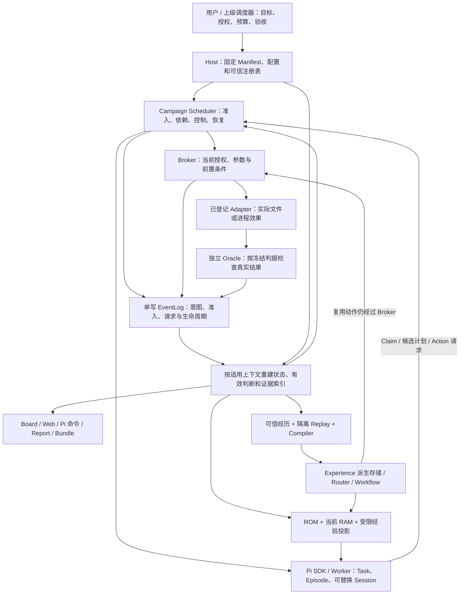

# Aegis 整体架构基线审计快照（2026-10-15）

**结论：项目已经有明确的整体架构；当前主要问题是部分跨模块契约没有落实到共同的执行与恢复接口。**
不能把反复补修都归因于需求缺失，也不能用若干局部测试通过证明整个任务完成。
先固定全系统的目标、权威边界与不变量，再判断问题模块应该怎样服从这些约束。

本文是独立的审计快照，**不修改产品代码、现有架构原文或既有验收标准**。
第 5 节仅索引已经确定的约束；第 8 节是修复建议，不是新增的已批准架构。
本快照以固定版本保存，后续修复不能通过修改基线、降低证据门或削弱原断言来宣称通过。

## 1. 固定版本、资料权威与审计范围

### 1.1 快照身份

| 项目 | 固定值 |
| --- | --- |
| 快照编号 | `SYS-20261015-01` |
| 审计起点分支 | `audit/completion-20261015` |
| 主仓库起点 | `4bf95130aead44443eb450d2d4150f6550225431` |
| 起点 tree | `044f4f1c126fe4aee8870f529becf5d806a09d0b` |
| 内嵌 Pi | `42a3497d03ad17e308a2299fa824727894f2c0ec`，本轮核对 clean |
| 起点工作树 | clean |
| 历史窗口 | `2026-10-14 17:00:00` 至 `2026-10-15 03:00:00`，`Asia/Shanghai` |
| 当前工作 | 整体架构与实现对照、既有失败证据归位、模块修复建议；未实施修复 |

所有源码事实指上述起点；文档提交后的 HEAD 变化不意味着产品源码变化。
历史窗口按 Git committer 时间复核，共 18 个提交；不是按报告文件的修改时间推断。
窗口明细与具体反例保存在 [E1 历史审计](E1_HISTORY_AUDIT_20261015.md)，本文不替换该记录。

### 1.2 资料的使用规则

优先级沿用 [开发规范 §1](AGENT_DEVELOPMENT_STANDARD.md#1-依据与适用方式)：
当前用户指令 > 已确认架构与数据契约 > 开发规范 > 子任务说明 > 历史任务书。
同一文件内也必须区分用户确认、推荐方案和历史进度；文件较新不自动取得更高权威。

| 来源 | 本快照采用的内容 | 不据此推断的内容 |
| --- | --- | --- |
| [THINK §9 用户回答](../THINK.md)、[架构决策](ARCHITECTURE_DECISIONS.md)的显式确认段 | LLM/执行边界、日志优先、写权限、四模式、Campaign 与只读观察的确认决定 | 决策文件整体仍有草案部分；推荐租约、容器等不自动成为已确认要求 |
| [MEMORY_SCHEMA](MEMORY_SCHEMA.md)及[运行时补充](MEMORY_SCHEMA_NOTES.md) | 四对象、来源、证据、有效视图、晋升门、学习效果标准 | 不能从 schema 合法推断实现正确，不能用记录数量证明学习 |
| [Campaign 契约基线 §2–3](CAMPAIGN_CONTRACT_BASELINE.md) | Manifest、身份、准入、预算、Outcome、修正及报告的精确约束 | 文件中的 C0 历史状态不是今天的工程状态 |
| [Campaign 架构](CAMPAIGN_ARCHITECTURE.md)、[产品路线](AEGIS_PRODUCT_ROADMAP.md)、[C6 任务](C6_AGENT_PRODUCT_TASK.md) | 上层编排复用既有 Runtime；工程与效果实验分离；已冻结能力范围 | 旧“未启动”等状态不覆盖后续验收证据；产品目标不等于全部已实现 |
| [C6 三事实任务](C6_THREE_FACTS_DSV41FLASH_TASK.md)、[E1 任务](E1_OBSERVABLE_PLANNING_TASK.md) | 已明确的生命周期和本轮规划/观察约束 | 修复子任务的通过不能改写全任务完成条件 |
| [架构.md](../架构.md)、[框架.md](../框架.md) | 原始目标、六类节点、验证优先、领域动机 | 文献数字不是 Aegis 的实测保证；旧词汇由后续正式 schema 映射 |
| 源码、测试、审查/交付报告 | 源码行为、实际反例、限定验收范围及其版本 | 注释、报告中的“统一”“全绿”不单独证明跨模块等价 |

几个容易混用的地方在此固定：旧“图板唯一真相”按后续契约解释为**事件是审计源、Oracle 是判定权威、图板是派生协调视图**；
早期 workspace/Sandbox 的表达按用户后续确认解释为 `workspace_is_sandbox=false`；
新 Session 不构成新独立 Episode。THINK §10 的待决事项须逐项与后续契约对照，不能整节当成当前未决清单。
本轮不修改这些原文，也不将尚未确认的建议补写为用户决定。

## 2. 全系统目标与实际结构

Aegis 的目标包含两个闭环：在授权与预算内完成可判定的任务；将独立验证的经历编译为可复用行为，减少以后重复探索。
Campaign 是编排层，Pi 提供模型与 Session 生命周期，已有 Runtime 提供动作、证据与经验机制。
六类图板节点是协调投影；不是在 Event / Episode / Outcome / Experience 之外再建一套长期真值对象。



图中“有效判断”表示规范要求的共同语义，**不表示当前已有一个覆盖所有消费者的统一实现**。
当前 queue、Board、学习 resolver 的实现路径不同，具体偏差见第 6 节。
这也不是新服务部署图；不要求新增数据库、消息总线、通用事务平台或 Agent 平台。

两条完整路径分别为：

1. 执行：输入校验与固定授权 → 静态/动态 Task 准入 → Episode 与 Session 绑定 → 请求前预算门 →
   模型候选 → 正常终止及结清检查 → durable 动作意图 → Broker → 效果 → 独立 Oracle → 有效结果 → 依赖推进。
2. 复用：可信 Outcome 与实际动作/环境证据 → 独立 Episode 与隔离 Replay → Compiler →
   版本化 Experience → 当前条件与 scope 匹配 → direct/habit/hint/deliberate → 同一 Broker → 再验证与反馈。

规划 Task 的 `plan_ready` 只证明计划满足规划门；业务结果与根目标仍需各自的冻结验收。
父子关系说明拆分来源，`depends_on` 才表达执行前置；父 Task 不因拥有成功子 Task 而自动成功。

## 3. 对象、写权与持久化责任

| 对象 / 状态 | 含义与合法生产者 | 消费方与持久化规则 |
| --- | --- | --- |
| Manifest、可信注册表 | 用户/可信 Host 固定目标、能力、Oracle、adapter 与预算；模型不能登记新能力 | Manifest revision/digest 固定；运行中授权更新须显式新 revision 与重新绑定 |
| Campaign | 上层任务边界、总预算和控制生命周期；Host/Scheduler 管理 | 单活动 Task/Episode；事件重建，checkpoint 仅缓存 |
| Task / Stage | Task 是可调度工作，Stage 是其判据分组；静态来自 Manifest，动态须经 Host 准入 | 当前已接受定义是调度与 Oracle 的依据；有同名 ID 或原始 proposal 不代表已接受 |
| Episode | 有目标、环境和授权边界的一次尝试；Runtime/Host 建立绑定 | Outcome、动作及证据必须关联实际 Episode；不是 UI 分组标签 |
| Session | Pi 对话载体；Host 在安全边界创建/替换并重新绑定 | 可跨多个 Session 延续同一 Episode；预算和未决责任延续 |
| Claim / Plan candidate | 模型提出待验证内容和计划 | 可保存为事件/候选；没有授权、Fact 或执行许可 |
| Action | 结构化执行请求；模型、Workflow 提出，Broker 校验执行 | 调用包装层先记录 durable 意图；效果与 completion 分别记录，结果不明先核对状态 |
| Provider request | 一次实际模型请求及 Task/Campaign 两侧责任 | provider 边界准入；durable 请求记录用于恢复，不能从 Session 结束猜是否消费 |
| Outcome | Oracle/有证据的独立人审对具体 criterion 的判断 | success/failure/unknown/invalid 分开；追加修正，不覆盖旧记录 |
| RuntimeState / Queue | Runtime 的派生生命周期、锁、预算、动作、任务状态 | LLM 不直接写；不同职责的投影 shape 不必相同，但同一事实不能互相矛盾 |
| Board / RAM | 六类节点和当前请求可用的信息 | 从事件及适用上下文派生；模型文本不升级为 Fact；RAM 不成为恢复或授权源 |
| Experience / routing | Compiler 产出带证据的 when/do/expect/scope；Router 按当前条件选择复用模式 | candidate 不能自动执行；active 存储必须与 committed 编译来源吻合，执行前仍重验 |
| Report / Bundle / Web | 确定性、有界、脱敏的观察与验收材料 | 不回写权威状态、不生成授权、不自动调用最终验收模型 |

事件日志对“发生过什么记录”提供审计来源；它不使日志中每条声明都自动成为真实结果。
`source.kind=runtime` 可以记录结构，不能单独给出独立 Oracle 判断；payload 自报 `oracle` 也不取得该写权。
固定本地可信 writer 是当前部署前提，不宣称已经抵抗恶意本机进程或任意不可信日志导入。

## 4. 实现职责与完整链路对照

下列路径均相对 `Pi_Agent_base/`。这是按职责的全局索引；第 10 节另列实际审查深度。

| 边界 | 主要实现 | 当前实现事实与边界 |
| --- | --- | --- |
| 产品入口与配置 | `memory/campaign/c6-entry.mjs`、`campaign-config.mjs`、`provider-config.mjs`、`e1-max-pilot.mjs`、`c6-runner.mjs` | 显式配置/模式；产品入口组装真实 SDK、Host、ledger 与 Oracle。operator 路径可按既有授权只读复用所选 Pi 配置；本轮未读取凭据或启动付费调用 |
| SDK 与工具入口 | `c6-sdk-runtime.mjs`、`c6-model-worker.mjs`、`extensions/aegis-observer.ts` | 受限资源与工具；每个新 Session 保留同一 Campaign gate。`aegis_read` 核对当前 Task 授权；普通 Pi read/write/bash 不因模型请求自动取得 C6 执行权 |
| 任务与编排 | `manifest.mjs`、`dynamic-policy.mjs`、`e1-plan-contract.mjs`、`e1-planning.mjs`、`scheduler.mjs`、`projection.mjs`、`queue.mjs` | 有纯校验、批次事件、队列重放、规划激活门；当前 Task shape、累计准入与 replay 身份仍有漂移 |
| Host 与单写恢复 | `host.mjs`、`c3-entry.mjs`、`stream.mjs`、`ownership.mjs`；`runtime/events.mjs` | 一个产品事件 sink，按物理提交顺序读取；队列写入/fsync/hash chain，部分持久化失败不作成功。single-host PID/目录所有权不是分布式租约 |
| 请求与预算 | `c6-tool-ledger.mjs`、`c6-request-lifecycle.mjs`、`c6-model-worker.mjs`、`c6-entry.mjs` | provider 前 Task+Campaign 联合准入；实际 transcript/tool schema 输入测量；逐侧责任、联合结清与规划终止分离。动态额度未正确接入现有门 |
| 动作授权和效果 | `runtime/action-contract.mjs`、`authorization.mjs`、`script-registry.mjs`；`campaign/broker-worker.mjs`及各 adapter | Broker 检查授权、Recognition/Procedure/Verification；Worker 先 durable intent，effect 前重验 grant；注册脚本固定 executable/参数并检查实际路径与版本；未知效果不能盲重试 |
| 独立验收 | `host-oracle.mjs`、`registered-test.mjs`、`outcome-resolver.mjs`、`aggregate.mjs` | Oracle 实测，resolver 核对 Task/Episode/criterion/scope/可解析 evidence，aggregate 按必需判据聚合。文件写入读回正确不等于外部测试成功 |
| 状态、上下文与轮换 | `runtime/state.mjs`、`board.mjs`、`ram.mjs`、`handoff.mjs`、`session-supervisor.mjs`、`handoff-host.mjs` | 逐请求 RAM、旧会话安全检查、真实 newSession/rebind/continuation 后确认完成；Observer 可借 Host writer。通用 Observer 与 C6 RAM provider 的上下文传递不同，需要纳入消费者清单 |
| 经验与贡献 | `runtime/evidence-resolver.mjs`、`experience-compiler.mjs`、`learning-store.mjs`、`learning-router.mjs`、`workflow-engine.mjs`、`learning-bridge.mjs`、`contribution.mjs`；`campaign/c6-learning.mjs` | resolved proofs、独立 Episode、隔离 replay、编译来源、路由 scope、同 Broker 执行均有门；数据获得/实际使用/验证推进分开，关联记录不自称因果效果 |
| 观察与交付 | `report.mjs`、`report-export.mjs`、`observation-view.mjs`、`observation-server.mjs`、`e1-observation.mjs`、`e1-task-graph.mjs` | loopback GET/HEAD、固定路由、有界脱敏、坏源不冒充当前成功；E1 同时调用 Board、queue 和 request summary，同批输入仍可能判定分歧 |
| 原型、实验与辅助入口 | `run-pi.sh`、`contest/`、`extensions/aegis-contest.ts`、`memory/fixture/`、三个 memory CLI、`login-relay.mjs` | 通用原型、提示卡/赛事实验、fixture 和结果导入是不同运行配置，不能据其工具集宣称 C6 可绕过 Broker，也不能据 C6 白名单宣称所有旧入口已受同等约束 |

`registered-test.mjs` 用 pinned 测试与 Host completion 识别真正完成，early exit/timeout 保留 unknown；
当前已核对 C6 代码验收调用传入受限测试环境。它不是 OS 隔离，不能据此声称能运行任意恶意测试代码。
当前 SIGTERM 控制是 Task 调度边界的 drain，活动 Task 可能继续到安全边界；SDK 的 error/aborted 执行门不等于立即取消活动 Task。
原型与 fixture 的存在不应驱动本次重写；将受控产品承诺推广到其他入口前，需要重新证明相应执行边界。

## 5. 固定准则：已确认不变量索引

以下 B 编号便于修复追踪，不创建新产品规则。引用来源在第 1 节，源码偏离不改变准则。

| 编号 | 固定准则 | 依据 |
| --- | --- | --- |
| B01 | 授权来自用户/可信 Host；Manifest revision/digest 固定。模型、经验、UI 不能扩大目标、能力、adapter、网络、凭据或预算 | 架构决策“Campaign 层”1–2；Campaign 基线 §3.1–3.2 |
| B02 | Campaign、Task、Stage、Episode、Session、criterion 各有归属；引用必须指向当前适用对象，缺失不当通配符；父子与依赖分开 | Campaign 基线 §3.2–3.3、§3.5；E1 OP-P/OP-A/OP-G |
| B03 | Event 追加且可校验，是审计源；checkpoint/store/snapshot/Board/RAM/report 可重建。记录完整、来源合规与业务转移有效分别校验 | Memory §1/§10；Campaign 基线 §3.3/§3.5；开发规范 §4.3–4.4 |
| B04 | 有副作用动作经 Aegis Broker，在效果边界重验当前授权、参数与条件；durable intent 在前。结果不明或审计失效时停止后续效果并核对真实状态 | THINK §9.1/§9.3；开发规范 §4.4；C3/C6 既有执行边界 |
| B05 | 受限动态扩展是核心能力；全图引用/环/判据覆盖/模板/数量/预算检查后才整批应用；E1 当前一次有效计划，增量重规划后置 | 架构决策“Campaign 层”2；Campaign 基线 §3.3；E1 OP-A |
| B06 | 静态与动态 Task 的分配都受 Campaign envelope；分配、未消费承诺、实际 consumed 不混用。每次 provider 请求同时受其 Task 和 Campaign 限额 | Campaign 基线 §3.4；C6 provider gate；E1 OP-L |
| B07 | 每侧预算责任、request 联合结清、planning termination 是三个独立事实；消费确认不丢失，pending=0 不代表 unresolved=0；error/aborted 不释放 buffered decision | C6 三事实 §3；C6 外部审查 §8；E1 OP-L |
| B08 | 只有可信且精确绑定、证据可解析的独立判定才能满足 criterion；Stage/Task 按完整 required 定义聚合；transport/模型自述/completed 标签不独立产生成功 | Memory §5；Campaign 基线 §3.5；E1 OP-B/OP-P |
| B09 | history、effective judgments、effective facts 分开；合法 supersedes 与环境失效保留历史；unknown 不生成 Fact，合法 unknown 修正可使旧 Fact 退出；普通失败不等于方法被 Refuted | Memory Notes §3–5；Campaign 基线 §3.6 |
| B10 | 同一 Campaign 的执行、依赖、Board、RAM、观察与报告，对相同上下文中的结果有效性不得相互矛盾；拒绝记录不能被另一视图重新提升 | Campaign 基线 U6、§3.5；E1 §4.1/OP-B；开发规范 §7 |
| B11 | 单活动 Task/Episode；Host 在 idle/settled、安全与预算门后换 Session；真实 Session 重新绑定完成才算轮换成功；不改变 Episode 独立性、不重置预算或重试未知效果 | 架构决策“Campaign 层”3/7；C2 契约；Memory §4 |
| B12 | Experience 是有 scope/provenance 的条件规则；candidate 不直接 active；晋升需独立验证、真实隔离 replay、无未决冲突等既有门，执行前当前条件与授权仍有效 | Memory §6.3；架构决策“可执行契约原则”；C6-C |
| B13 | 获得数据、实际采用、验证阶段推进分别记录；上下文出现不等于有贡献，阶段贡献不等于一般因果性，工程门通过不等于已证明学习收益或跨任务泛化 | 架构决策“数据有用性”；Memory §8；产品路线 §1/§5 |
| B14 | 观察面只读、有界、脱敏并显示 unknown/截断/完整性；不授予权限、不启动 SDK/付费调用或自动最终验收；workspace 明确不是 OS sandbox | 架构决策“Campaign 层”1/5/6；Campaign 基线 §3.7；C4/C4a；E1 §4.1 |

这组准则约束修复方向，不要求本轮补齐尚未承诺的通用 shell、CTF 适配器、容器隔离、多 Worker、
分布式取消、权重训练或学习效果实验。既有阶段的限定验收继续成立，不扩大为全项目安全认证。

## 6. 整体实现审计判断

### 6.1 可以保留的基础

主链已具备分层：Host 管理授权与编排、Broker 管理执行、Oracle 管理判定、EventLog 管理审计记录、Compiler 管理经验晋升。
请求生命周期已有共用 reducer，保留逐侧责任、联合结清和终止分类；不能为修 E1 把它们折成一个 `ok`。
动作与注册测试能产生真实本地效果和独立验证；Session 轮换有真实 SDK 绑定过程；报告与观察走派生只读路径。
学习链有证据解析、独立性、replay、store 来源和 routing 门，不能将其描述为“只有提示词记忆”。

上述结论是源码结构与已有限定证据的综合判断，**不是本轮重新验收这些模块全部边界**。
保留这些基础，才能将修复限制在真正失配的接口，而不改变已确认架构。

### 6.2 已定义却没有一致实现的地方

| 失配 | 当前实现事实 | 违反准则 / 证据级别 |
| --- | --- | --- |
| 执行 Task 预算 shape 不一致 | 动态定义用 `budget_reservation`，Worker ledgerFactory 读 `task_budget` 并回退总额度 | B06；HA-02 已由实际 provider 边界复现 |
| 准入使用旧状态，批次规则未闭合 | entry 在循环外算 projection，多个候选复用，reducer 未独立守住累计分配及一次有效计划 | B05/B06；HA-03 为真实 Host committed 流反例 |
| 相同 Outcome 被解释为不同可信度 | queue 经 Campaign resolver 拒绝，Board 另写弱判定；Board 从原始 admission 索引定义 | B03/B08/B10；CA-02–05 已复现，C6 RAM 消费该 Board |
| live 与 replay 的合法计划不同 | live 全图编译，replay 对规划身份、原候选与规范化执行定义的绑定较弱 | B02/B03/B05；CA-06–09/12 已复现 |
| 根目标引用只验形状 | `root_goal_ref` 非空却未与冻结 planning context 比较 | B02；HA-04 已复现；未证明跨 Campaign 授权突破 |

这些条款在既有规格中已经存在，主要属于**实现漂移与集成责任缺口**，不能归为用户没有定义需求。

### 6.3 需要补齐精确定义的模块接口

下表是从全系统出发发现的契约表达不足；不是额外已复现漏洞清单，也不是新增产品需求。

| 接口缺口 | 为什么影响整体 | 建议精确化的内容 |
| --- | --- | --- |
| “命令成功”的返回语义 | Scheduler commit 说明 append 结果，不证明 projection 接受；entry 可能把两者混用 | buffered、durable record、accepted transition、activated 分别返回什么，附哪条 event/prefix 和拒绝原因 |
| 执行 Task 的公共定义 | 准入、调度、ledger、Oracle、RAM 各取部分字段，静态/动态出现同义不同名 | 唯一消费者 shape、预算适配入口、必需身份与 criterion、缺失/兼容行为 |
| 冻结上下文到恢复的传递 | live 可拿到模板/根目标，事件有 candidate digest 不等于 replay 有同样可信输入 | Manifest/模板/策略/规划身份的固定来源、摘要覆盖、加载路径、缺失时能观察与能执行的区别 |
| 共同“有效判定”的适配 | 一条日志可被多个模块作不同业务解释；只有 share EventLog 不够 | 同一 Campaign 的 accepted definitions、适用 Episode、resolved evidence、effective judgment 与拒绝诊断如何交给消费者 |
| 分配账本与请求账本的对应 | allocation reservation、每侧 request hold、consumed 是不同账目 | 各维度单位、转移/释放时点、恢复责任，避免重复扣减或误放宽额度 |
| 契约与验证的共同覆盖面 | 子任务通过表无法证明拒绝不会在下游被重新接受 | 同一输入跨 live、重放、RAM、观察、Compiler 的一致性断言，以及有界序列/故障前缀 |

其中前四项可在现有库的纯函数与 Host 边界内闭合；不要求一个巨型全局 resolver，也不要求替换所有旧接口。
接口函数名、持久化 shape 与兼容迁移仍是**实施前应审查的具体设计**，本快照不伪称已经确定。

### 6.4 尚未证明的影响与后置项

`runtime/evidence-resolver.mjs` 与 Campaign resolver 路径不同；Compiler、Router、Workflow 有自己的严格证据门。
需要验证同一 Campaign 中被拒 Outcome 不会经 bridge 成为编译支持，但目前**没有独立反例证明错误 active 晋升已发生**。
Observer、session supervisor、C6 ramProvider 的 Board 构造上下文也不完全相同；这是消费者接线核验项，不能把不同入口直接当成已复现绕过。

checkpoint 的计划字段完整性、其他 adapter 的全部异常路径、本机恶意进程、任意不可信测试代码等，本轮没有全面验证。
F16 缓存、全仓严格类型化、未来入口统一、CTF/固件/日常任务族和 E2/E3 效果实验保持原责任阶段。
文档入口的历史状态不同步属于交接债；本轮保留原文，并以版本与证据区分，避免继续制造无版本的“当前通过”。

## 7. 历史任务在整体基线中的定位

时间窗口内的 A、B、C、FC 是同一个 E1 可观察规划任务的补修，不是四种架构或四个独立产品承诺。
原任务是在既有执行、证据、上下文和观察架构上增加模型整图规划；这个增加同时触及多条已存在的准则。

| 修复轮 | 有效交付 | 未由该轮局部验收证明的部分 |
| --- | --- | --- |
| A `bc93cca` | 规划正常结束、请求结清、独立 Oracle、持久完成后才激活 | 完整计划身份与 normalized 定义、累计分配和所有消费者一致性 |
| B `94463cc` | 实际 planner 输入携带冻结契约，可信模板与 criterion 子集约束 | 动态 Task 额度到 provider、重复计划、root 引用与 replay 等价 |
| C `d3f6630` | 观察重放、Campaign Outcome 到图板的路径、计划候选 digest | Board 是否采用与 queue 相同的归属/证据判定，非法 admission 是否被重新索引 |
| FC `17d7aff` | 部分缺字段、来源和 digest 检查 | “字段存在但值非法”“双方都缺”“候选相同但执行定义变化”等组合边界 |

HI-01/02/05 主要继承自窗口前初版，不应全部归责于后来的修复。
HI-03/04 则说明添加投影和恢复检查时没有完整复用既有判定边界。
原测试仍有价值；问题在于其结果被用于支持比实际覆盖更大的完成结论。

| 现有发现 | 级别 / 当前任务分类 | 有界实证 |
| --- | --- | --- |
| HI-01 | P1 / E1 当前阻塞 | 三个动态 Task 各分配 1 次请求，实际各用 2 次且完成，共 3 次 Broker 文件效果；未证明 Campaign 总实际请求超限 |
| HI-02 | P1 / E1 当前阻塞 | Campaign 限额 100，两批分别可准入；planning 分配 8 后总 reservation 从 68 到 128，后批执行、前批仍 queued；128 是分配量，实际消费 8 请求 |
| HI-03 | P1 / E1 当前阻塞 | scope/criterion/evidence 被 queue 拒绝的结果仍成为 Board Fact；被拒 admission 的定义仍被 Board 使用 |
| HI-04 | P1 / E1 当前阻塞 | 缺规划身份/候选与 normalized 失配可重放接受；缺身份 ready 前缀在新进程恢复后发生 6 次 faux 请求、3 次 Broker 效果 |
| HI-05 | P2 / 当前非阻塞，随身份修复 | foreign-root 仍可准入完成，但没有解除固定模板、目标和 capability 检查；不是跨 Campaign 授权突破证据 |

CA 的语义变异用例重算并核验事件链，证明业务解释分歧，不证明模型有能力伪造可信 Host 来源。
CA-12 是真实产品 durable 前缀的新进程恢复，**不是 SIGKILL 故障实验**；已有 C6 SIGKILL 证据属于另外的限定范围。

## 8. 受整体基线约束的模块修复建议（尚未实施）

### S0：先让关键接口可审查

先完成一张小而完整的接口表：输入/输出 shape、字段来源、状态轴、缺失行为、拒绝原因、幂等、事件对应、恢复输入与消费者。
以 B01–B14 为固定条件，覆盖以下五个接缝：

| 接缝 | 建议责任归属 | 必须交给下游的语义 |
| --- | --- | --- |
| 固定运行上下文 | Host/config 与可信注册表装配 | Manifest revision/digest、根目标、规划 Task/Episode、模板/策略身份及可恢复来源 |
| 规范化执行 Task | manifest/dynamic/plan 边界适配；Scheduler 只派发规范结果 | 身份、target/capability、依赖、Oracle/criterion、scope 与明确分配；不能让 Worker 自猜 |
| 计划决定与应用 | plan 纯契约 + projection 状态转移 + Host 单写命令 | 对当前已接受前缀的全图决定、完整 normalized 定义、预算变化、accepted/rejected 诊断 |
| 有效 Outcome | 各域 resolver，经 Campaign 适配提供一致结论 | 当前合法定义与 Episode、可解析证据、effective judgment、Fact 资格所需来源，不复制弱校验 |
| 命令结果 | Host/Scheduler | 写入是否 durable、转移是否采纳、对应 event/prefix、激活是否成立；不能以一个 `ok` 替代 |

这些是建议的接口责任，不擅自成为新的持久对象或协议版本。
已有非 Campaign 域可以保留自己的输入格式；同一 Campaign 的相同判断必须由适用上下文给出一致结果。

### S1：计划准入与 replay 闭合

对应 HI-02/04/05，遵守 B01–B03/B05/B06/B08。
主要范围：`e1-plan-contract`、`e1-planning`、`scheduler`、`projection`及 entry 的提交接线。

- 在现有 Host 单写命令内使用最新 committed 前缀判定；每次成功提交后，下次判定必须包含这次结果。entry 预先计算的旧 projection 不成为准入权威。
- live 与 replay 使用共同的确定性编译/校验规则，绑定 Campaign/revision/root、planning Task/Episode、内外 plan_id、candidate、可信模板及 normalized 执行定义；digest 匹配不能代替归属与合法性。
- 全图检查完才应用；拒绝不改变已接受 Task/分配/执行资格，留下可观察原因。append 成功后仍确认该转移被接受，不能把被拒 admission 返回为成功。
- 保持现有“一次有效计划，增量重规划后置”。重复提交须明确区分完全相同的幂等与冲突；额外候选可留审计，不能静默让最后一批覆盖、生成第二个有效批次或清空首次合法状态。
- 固定恢复上下文的来源。缺可信模板/身份时允许只读诊断，禁止猜测授权或新执行；保留原日志，不自动迁移补造身份。

验收：CA-06–09/12、HA-03/04 转绿；完全重复不重复分配/效果，冲突不覆盖；先非法再合法仍可正常处理；
正常合法恢复对照保持通过，A 的终止、独立 Oracle、durable completed/ready 门保持不变。
多版本计划替换、多批增量策略不在这次修复中暗中设计。

### S2：执行 Task 与两层预算贯通

对应 HI-01 及 HI-02 的额度一致性，遵守 B06/B07/B11。
主要范围：Task 规范化、Scheduler 派发、`c6-entry` ledgerFactory；复用现有 ledger/lifecycle。

- 静态 `task_budget` 与动态 `budget_reservation` 在可信边界映射为同一执行额度，Worker 只读规范结果；动态额度缺失/非法时不能回退为整个 Campaign 额度。
- 旧静态配置只保留既有、明确的兼容缺省，在入口解析一次；不通过全面删除旧兼容来隐藏新接线缺陷。
- 分开 allocation、request hold、consumed；分配会计与实际请求会计分别核对且可对应。不能把同一调用在剩余承诺和 consumed 中重复扣减，也不能拿 Campaign 余额代替 Task 余额。
- 请求前继续联合检查 Task/Campaign；恢复、换 Session、失败和 continuation 不抹消费或未决责任。保留 C6 已确认的逐侧 reconciliation 与 unresolved guard。

数值验收示例：Campaign=20，规划分配6，三个业务 Task 各4，总承诺18；若四个 Task 各消费2，
在未释放剩余分配、无 pending/unresolved 时，consumed=8、未消费承诺=10、可新增分配=2。
实际请求余额12与可新增分配2不能共用一个未标含义的 remaining。
HA-02 必须在第二次超额请求到 provider 之前拒绝；工具效果必须随真实许可变化，而不是只修报告计数。
恰好耗尽、拒绝 continuation、异常逐侧结清及 fresh-process 恢复应对照真实数值。

### S3：结果有效性贯通消费者

对应 HI-03，遵守 B03/B08–B10/B12/B14。
主要范围：Campaign resolver/投影输出、Board 适配、C6 与 Observer RAM 接线、观察/report；学习 bridge 作为需验证消费者。

- Board 使用已接受的定义与实际 Episode 绑定，不从所有原始 admitted/started 记录自行授予合法身份；Campaign Outcome 复用同一证据解析与接纳结论。
- Board 保留节点组织、历史、supersedes/stale 和文本职责；queue 保留调度与聚合职责。共同语义可以通过纯结果/适配接口提供，避免 Board 与 queue 互相整图重建或复制 resolver。
- 逐一登记 Scheduler、Board、C6 ramProvider、Observer snapshot/request RAM、Web/Pi、report、learning bridge/Compiler 的实际调用点，明确适用的 Manifest/证据上下文；相同日志不代替这一核验。
- 拒绝保留诊断而无 Fact/成功依赖/编译支持资格；合法 unknown 留在 judgment 视图，合法 unknown 修正仍可退役旧 Fact；普通失败不直接成为 Refuted。
- 对学习链先验证被拒 Campaign Outcome 不会进入有效支持，继而保留原 Compiler/独立性/replay/store 门；不以本次修复顺带放宽晋升或声称已证明学习收益。

验收：CA-02–05 转绿；同一结果在 queue、Board、RAM、观察、report 的接纳与有效性一致；
Compiler 对被拒支持明确拒绝或保持 candidate。正常 Fact、合法 unknown/correction、scope 失效与非 Campaign 原行为保持原断言。

### S4：以一条完整主链收尾

S0 是共同前置；S1 与 S2 共享 Task/预算契约，S3 依赖 S1 输出的合法定义和绑定。
它们是同一任务内的实施步骤，不能把一组绿测当成整个 E1 完成。
集成验收走输入 → 真实 SDK/faux → 候选 → Host → 动态依赖 → 实际效果 → 独立 Oracle → RAM/观察/报告 → 重启重建。
维持现有工具白名单、单活动 Task、真实配置与 Pi-core 边界；本轮修复不依赖付费模型实验。

旧 [E1 历史审计 §8](E1_HISTORY_AUDIT_20261015.md#8-将多轮补修还原为一个架构问题2026-10-15-补充分析)
中的接口收拢建议可以作为输入，但今后以本文固定的**整体约束**评估它们，不能倒过来用几个反例重新定义整个架构。
尤其保留各域 resolver 的职责、区分所有入口的运行承诺，学习影响保持待验证；不将旧建议图当成已实施或已获确认的架构。

## 9. 后续实现的契约验收矩阵

这是待实施验收要求，**以下新增组合验证本轮尚未执行**。
采用现有 Node/faux/本地 Oracle 工具即可；关注结果等价与真实 effect，不按新增测试数量衡量质量。

| 验收项 | live / 提交 | replay / 新进程恢复 | RAM / 观察 / 学习消费者 | 已有失败证据 |
| --- | --- | --- | --- | --- |
| 身份与编译绑定 B01–B03/B05 | 缺失、foreign、candidate/normalized/context 冲突都不采纳 | 同一可信输入给出相同合法定义；缺上下文不执行 | 不展示被拒定义为合法 Task，不作为支持 | CA-06–09/12、HA-04 |
| 批次与序列 B05/B06 | 两次提交、重复、冲突、先拒后合法；整批无部分 mutation | 每个 committed 前缀重建同一已接受集合、分配与激活 | 被拒候选留审计，无 Fact/依赖/执行效力 | HA-03、CA-05 |
| 实际额度 B06/B07 | Task 与 Campaign 恰好额度/超额在 provider 前守住 | consumed/hold/unresolved 按侧和 request 身份不丢、不重扣 | 数值含义、unknown 与 pending/unresolved 如实展示 | HA-02；既有 C6 生命周期断言 |
| 真值 B08–B10 | scope/criterion/evidence/当前 Episode 不匹配不得成功 | 同一有效 judgment、required 聚合与修正状态 | 同一 Outcome 接纳结论一致，拒绝支持不能 active | CA-02–05；既有 supersedes/unknown 断言 |
| 安全效果 B04/B07/B11 | 意图不 durable、结清不完整、终止异常时零后续 effect | 保留已可能发生效果，不盲重试；同计划不重复效果 | 不冒充成功，不把审计错误编译成方法失败 | 既有 A writer-fault 与 C6 fault/restart 断言 |
| 派生重建 B03/B10/B12/B14 | 当前行为由权威输入决定 | 删除可丢弃派生物后重建，不靠旧 checkpoint/store | RAM、Board、report、store 保留来源与当前有效性 | 既有重建对照，需增加上述同 Campaign 组合 |

每条断言记录输入版本、事件前缀、拒绝原因、实际 provider 次数、实际 Broker 效果和证据引用。
前缀重放不能代替真实进程中断；已有 SIGKILL 检查保留适用范围，只有改动影响该路径才补相应故障证据。
修复后按 [E1 required 清单](E1_REPAIR_REQUIRED_CHECKS.json)运行受影响必需组及 CA/HA，保留所有有意义原断言。
类型与格式按实际覆盖报告，不关闭检查来制造通过；非阻塞/后置项按开发规范 §3.1 处理。

## 10. 审查覆盖与实际验证

### 10.1 静态盘点和人工审查范围

基于 `git ls-files Pi_Agent_base`，主仓库跟踪 218 个文件，其中测试/辅助测试目录 120 个文件。
本轮对非测试实现提取文件、行数、import/export 与边界调用清单，包含 89 个源码文件、36,061 行：

| 区域 | 源码文件数 | 行数 | 审查深度 |
| --- | --- | --- | --- |
| `memory/runtime/` | 23 | 8,772 | 主链人工核对：事件/状态/图板/RAM、动作授权、Session、证据、Compiler/Store/Router/Workflow；并非每文件逐行审计 |
| `memory/campaign/` | 46 | 18,210 | 主链人工核对：Host/准入/队列/replay/请求门、Oracle、观察/report、学习接线；部分 adapter 只核对接口/边界 |
| `extensions/` | 3 | 3,304 | Observer writer/投影/逐请求上下文/动作/学习接线重点核对；contest/fixture 扩展较浅 |
| `memory/fixture/` | 9 | 2,657 | 现有 fixture/Router/Oracle/Compiler 定位与既有报告交叉核对，非本轮全面异常审计 |
| memory 顶层 CLI | 3 | 1,252 | live/replay Oracle、编译入口定位与证据角色核对，非全部 CLI 参数复测 |
| `contest/` | 3 | 1,415 | 启动模式、结果导入和日报边界，避免与 C6 承诺混用 |
| 顶层启动/login | 2 | 451 | 通用启动与受控入口的差异；login relay 仅静态清单/定位，未做认证流程实测 |
| 合计 | 89 | 36,061 | 静态清单覆盖全部上述源码，不等于 36,061 行逐行语义审计 |

私有静态清单：`Pi_Agent_base/runtime/dev/system-baseline-20261015/source-inventory.json`。
补查了 ROM、Biome/两份 TypeScript 配置、核心规范及阶段状态来源；没有用宽泛搜索读取配置凭据。
未对内嵌 Pi 全库、依赖、所有历史文档、所有测试文件做完整逐行审计；没有本轮浏览器交互或真实 provider/目标实验。
Campaign 与 Batch-E 的类型配置覆盖不同，不能说任一配置覆盖全部扩展与全仓库。

### 10.2 已有执行证据与本轮检查分开

下列是**本会话较早已实际执行**、与当前源码基线相容的离线测试；本轮整体文档审查没有重复运行它们：

```bash
node Pi_Agent_base/tests/helpers/c6-suite-runner.mjs \
  Pi_Agent_base/runtime/dev/history-audit-20261015/final \
  aegis-e1-external-review aegis-e1-fail-closed-repair \
  aegis-e1-planner-input aegis-e1-observation-repair \
  aegis-e1-planning-gate-audit aegis-completion-audit aegis-e1-history-audit
```

总体退出码 **1**。原五组 48/48 pass；completion audit 为 3 pass / 9 fail；history audit 为 1 pass / 3 fail。
逐脚本退出码已重新读取核对，保存在 `runtime/dev/history-audit-20261015/final/results.json`；
具体用例、私有证据路径和证明限制见两份 [完成度审计](PROJECT_COMPLETION_AUDIT_20261015.md)与[E1 历史审计](E1_HISTORY_AUDIT_20261015.md)。
这些失败是待修复基线，**本轮没有将其转绿，也没有修复产品**。

本轮实际检查：起点/结束 Git 状态与 Pi 版本、历史窗口 committer 时间、tracked 源码结构、关键主链及规范对照；
新文档全文审查、引用路径与固定数量核对、`git diff --check`、暂存 diff 审查。
文档提交前执行并捕获这些检查的实际结果；只改文档，不新增或修改测试，也未复跑 tsc、全 59/62 脚本。
既有 Campaign/Batch-E 诊断数与 C1–C6 验收是各自历史基线，本轮不把它们改称零错误或全系统复验通过。

## 11. 交付状态

全系统的职责、数据/信任/持久化边界与固定准则已经归位，E1 的五组发现已映射到这些准则。
建议保留现有分层，通过规范执行 Task、Host 命令与 replay、有效判断消费者三个接缝修复，保持既有 C6 三事实和执行门。
待实施内容是 S0–S4；整体 E1 仍为 **changes_required**，学习污染影响与部分接线一致性仍需验证。

本轮交付仅新增这份审计快照，不改代码、现有架构/规范、历史报告、测试、Pi 核心、配置或依赖。
后续修复应引用快照编号和 B 编号，以原准则检查实现；涉及新的产品语义另行明确并保留版本记录，不能在修复中悄悄改变基线。
